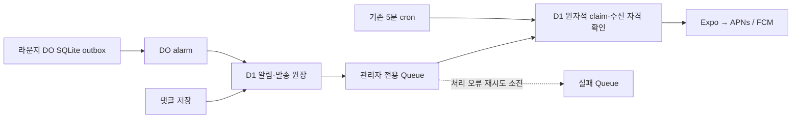

# 관리자 댓글·라운지 앱 알림

새 댓글(공지·릴리즈 노트)과 라운지의 새 채팅을 지정한 관리자 한 계정의 등록된 앱 기기로 보낸다. 일반 사용자에게는 발송하지 않는다. 관리자 작성분과 수신자 자신의 작성분은 제외한다.

## 수신과 이동

- 댓글: 닉네임·본문 미리보기, 해당 글로 이동한다. 글을 열 때 상세 메모를 비워 새 댓글을 읽는다.
- 채팅: 닉네임·본문 미리보기, 라운지로 이동한다. 특정 메시지로 스크롤하는 기능은 없다.
- `community` 분류로 알림함과 운영 도구의 푸시 실적에 기록한다. 앱이 열려 있어도 OS 배너에 표시한다.
- 운영에서는 D1 저장 직후 Cloudflare Queues로 관리자 알림을 처리한다. 기존 개인 푸시 소비자(5분 cron)는 Queue 발행 실패·처리 중단 복구와 영수증 확인을 맡는다. 일반 사용자 알림은 기존 cron 경로를 유지한다.
- 운영 알림은 야간에도 발송하며 하루 2회·한 시간 간격의 일반 개인 푸시 예산을 쓰지 않는다. 일반 사용자 알림과 컵 알림의 기존 시간·예산 정책은 유지한다.
- 앱의 이 기기 알림 수신을 끄거나 로그아웃·세션 만료·기기 등록 해제·계정 삭제되면 해당 기기로 보내지 않는다. 친구 알림 수신 여부와는 별개다.

## 활성화

기본은 꺼져 있다. 운영 반영 시 다음 순서로 확인한다.

1. 앱에 `community` 분류와 `chat` 이동 대상을 포함한 업데이트를 게시하고, 수신 관리자 앱에 적용되었는지 확인한다. 이전 앱에서는 새 분류의 알림함을 읽지 못할 수 있다.
2. 기존 `PERSONAL_PUSH_ENABLED=1`과 관리자 앱 기기 등록을 확인한다.
3. `ADMIN_COMMUNITY_PUSH_EMAIL` secret에 관리자 본인 이메일 하나를 지정한다. 값은 `ADMIN_EMAILS`에도 있어야 하며 Google 연결이 검증된 활성 프로필이어야 한다. 생략 시 `ADMIN_EMAILS`가 정확히 한 항목일 때만 그 값을 사용한다. 여러 관리자가 있고 수신자를 지정하지 않으면 발송하지 않는다.
4. `ADMIN_COMMUNITY_PUSH_ENABLED=1` secret을 켠다. 일반 사용자의 테스트 댓글·라운지 메시지 각각 한 건으로 대상·중복·탭 이동·실기기 수신을 확인한다. Expo 접수·영수증은 실제 화면 수신과 구분한다.

중단은 `ADMIN_COMMUNITY_PUSH_ENABLED=0`으로 한다. 새 큐 등록을 중단하고, 기존 대기 발송도 수신자 검증에서 취소된다. 과거 댓글·채팅을 소급 발송하지 않는다. 개인 이메일·프로필 ID·푸시 토큰을 저장소에 커밋하지 않는다.

## 저장과 재시도

- 댓글은 원본 저장과 알림·발송 큐를 같은 D1 batch로 커밋한다. 발송 전 댓글·게시글 삭제 여부와 수신자 관리자 자격을 다시 확인한다.
- 라운지는 Durable Object SQLite에 메시지와 작은 outbox를 함께 저장하고, 사이에 await 없이 alarm을 예약한다. D1 등록 실패는 alarm에서 다시 시도하며 메시지 ID 기반 source key가 중복 알림·큐 생성을 막는다. 숨긴 메시지는 outbox 처리 시 제외한다. D1에 이미 등록된 채팅 미리보기는 이후 숨겨도 남을 수 있다.
- outbox는 한 번에 50건, 이후 1분에 이어 처리하며 24시간이 지난 항목은 버린다. D1 발송도 기존 24시간 만료·lease·불명확 전송 결과 재발송 방지 정책을 따른다.
- 등록된 앱 기기의 프로필 ID를 기준으로 수신자를 조회하고 기존 PK·기기/세션 인덱스를 쓴다. 공개 조회·새 폴링·D1 스키마 변경은 없다. DO 테이블·인덱스는 최초 실행에서 만든다.

운영자 전용 변경이므로 일반 게임 내 릴리즈 노트는 게시하지 않는다(`release-notes: none`).

## Cloudflare Queues 시범 적용 (T-11-205)

- 운영 Queue: `offside-admin-push-production`, 실패 Queue: `offside-admin-push-production-dlq`. 기존 API Worker가 생산자·소비자다. staging/local에는 운영 Queue를 연결하지 않는다.
- Queue에는 `{version: 1, sourceKey}`만 넣는다. 본문·이메일·기기 토큰은 싣지 않는다. 생산은 D1 커밋 후 await하며, Queue 발행 실패가 저장된 댓글·채팅의 성공을 뒤집지 않는다.
- 소비 배치는 최대 10건, 대기 최대 1초, 소비자 동시성 1이다. 메시지별 source key와 `community` 종류로 범위를 한정한다. D1의 기존 due/state 인덱스와 notifications PK를 사용하며 새 스키마·공개 조회·폴링은 없다.
- Queue 중복 전달과 cron 경합은 같은 D1 claim으로 조정한다. 삭제된 댓글, 해제된 기기, 수신 권한 등은 발송 직전 다시 검사한다.
- Expo의 명시적 429/5xx는 D1 backoff에 맞춰 Queue에서 재시도한다. Queue 최대 재시도 3회 후 DLQ로 이동한다. D1에 남은 대기 건은 cron이 계속 복구한다. 제공자의 확정 실패는 D1에 기록하고 ack하므로 DLQ에 들어가지 않는다.
- 응답 유실·타임아웃·Expo 접수 후 DB 기록 실패처럼 발송 여부가 불분명한 건은 기존 `unknown` 정책을 유지하며 맹목적으로 재전송하지 않는다. 영수증 확인은 기존 15분 due/cron 처리다. Expo 접수·영수증 성공이 실제 기기 배너 확인을 대신하지 않는다.

### 배포와 되돌리기

1. 지정 운영 계정에 위 두 Queue를 생성한 뒤 생산자·소비자 binding이 포함된 API를 배포한다. 보존 기간은 각각 24시간으로 설정한다.
2. `ADMIN_COMMUNITY_QUEUE_ENABLED=1`은 Queue 가속만 켠다. 기존 `PERSONAL_PUSH_ENABLED=1`, 관리자 수신 설정과 `ADMIN_COMMUNITY_PUSH_ENABLED=1`도 필요하다.
3. 운영 Queue 소비자 연결·오류·잔량, `community-queue-publish`/`community-queue-send` 로그, D1 발송 상태를 확인한다. 자연 발생한 관리자 알림과 실제 앱 수신을 별도로 확인한다. 테스트용 공개 글·댓글·채팅이나 푸시를 임의 생성하지 않는다.
4. Queue만 되돌릴 때는 `ADMIN_COMMUNITY_QUEUE_ENABLED=0`으로 API를 배포한다. 이미 들어온 메시지는 ack하고 D1 대기 건은 기존 cron으로 처리한다. 관리자 알림 자체 중단은 기존 `ADMIN_COMMUNITY_PUSH_ENABLED=0`을 쓴다.
5. DLQ는 무조건 재생하지 않는다. 원장 상태·만료·장애 원인을 먼저 확인한다. `sending`/`accepted`/`confirmed`/`unknown`은 강제로 pending으로 바꾸지 않는다.

검증 범위: D1 rollback과 Queue 장애 복구, 라운지 outbox, Queue 재전달·cron 경합, 일반 알림 격리, 삭제 취소·기능 중단, throttling backoff, 불명확 전송의 재발송 차단. 실제 workerd의 Queue 생산·소비와 D1 연결도 로컬에서 확인한다.
