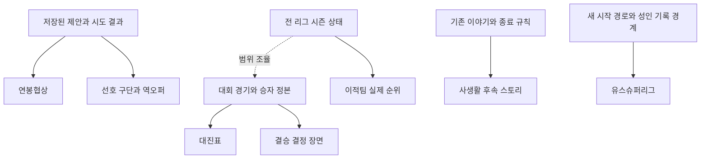

# 유저 피드백 잔여 과제 기획

> T-11-239 · 문서 전용 PR · 2026-10-13 원격 main `1a67ecd7` 기준
> 각 문서는 제안안입니다. 문서 병합으로 기능·수치·저장 형식이 적용되지는 않습니다.

## 현재 남은 내용

사용자가 전달한 10개 제안에서 **핵심 신규 기능은 임금협상, 결승 결정 장면, 유스슈퍼리그, 선호 구단·역오퍼**입니다. 대진표는 트로피 연출 다음 단계이며, 사생활 스토리와 실제 타 리그 순위는 부분 구현 이후의 확장입니다. 사치품·사업은 별도 예정 작업과 조율할 경계 문서로 둡니다.

| 원 제안 | 현재 확인 상태 | 남은 내용과 기획 |
| --- | --- | --- |
| 1 메이저 대회 대진표·애니메이션·트로피 | T-11-238에서 트로피 그림·결산 등장 연출 로컬 구현 | [대회 상대와 진출 경로, 전체 녹아웃 대진](01-major-tournament-bracket.md) |
| 2 도트 키 반영·골키퍼 옷 | 사용자가 #609에서 함께 작업 중이라고 지정. [PR #609](https://github.com/tasddc1226/offside-football-simulator/pull/609)는 조회 시 OPEN | 기존 PR의 인수 조건으로 키 반영·GK 유니폼을 확인. 별도 구현/기획을 중복 생성하지 않음 |
| 3 임금협상 | main에는 제시된 연봉 수락과 재계약 계산만 존재 | [연봉 한 항목의 제안별 1회 협상](03-salary-negotiation.md) |
| 4 사치품·사업으로 스탯 상승 | 사용자가 별도 작업 예정이라고 지정. 자기 투자·잠재력 강화는 이미 별개 기능으로 존재 | [선수 경제와 반복 효과의 경계](04-luxury-business-boundary.md). 담당 작업 정본과 조율 |
| 5 논란·WAGs 같은 선택지 | 기존 파티/스캔들 스토리 존재. T-11-238에서 성인 프로 단발 연애설 로컬 구현 | [완결되는 후속 이야기와 SNS 발언 소재](05-controversy-story-expansion.md) |
| 6 결승 터치게임 | 이벤트 선택용 타이밍 미니게임은 존재. 커리어 대회 결승 결과와 직접 연결된 기능은 아님 | [결승의 마지막 킥/선방과 중단·재개](06-final-decisive-minigame.md) |
| 7 국가에 맞는 라이벌 이름 | T-11-238에서 첫 등장 리그 국가별 이름과 기존 이름 유지 로컬 구현 | 현재 합의한 작은 범위는 구현됨. 추가 기획 없음 |
| 8 5대 리그 유스슈퍼리그 | 현재 한국 고교→대학/프로 시작 경로 | [새 커리어용 가상 유스 경로](08-youth-super-league.md) |
| 9 선호팀·역오퍼 | 선호 구단·지원 결과 상태 없음 | [선호 구단과 시장별 관심 요청](09-preferred-club-application.md) |
| 10 이적팀 현재 순위·챔스 여부 | T-11-238에서 예상 순위와 첫 이적 시즌 대륙 대회 로컬 구현 | [확인 가능한 같은 리그 순위, 전 리그 실순위 확장](10-transfer-club-information.md) |

**T-11-238은 별도 로컬 워크트리의 구현 상태이며 아직 이 PR의 main 기준에 포함되지 않습니다.** 웹 QA 완료와 운영 출시를 구분합니다. 이 문서 PR에는 그 코드·캡처·테스트 저장 데이터를 넣지 않습니다. #609도 PR 제목·본문만으로 키/GK 요구가 모두 충족됐다고 판정하지 않습니다.

## Phase 0 조사 근거와 허용된 기반

| 기반 | 현재 존재하는 API 또는 패턴 | 참고 위치 |
| --- | --- | --- |
| 계약/시장 | `makeOffers`, `offerFrom`, `renewalSalary`, `canAcceptRenewal`, `acceptOption` | `packages/game/src/season.ts`, `earlyRenewal.test.ts` |
| 사인과 확정 | 공용 `showContract`/`signContract`, 웹·앱 계약서 | `packages/app-core/src/game-actions.ts`, 각 `sheets/Contract` |
| 자기 투자 | `INVESTS`, `investCost`, `applyInvest` | `packages/game/src/training.ts`, `invest.test.ts` |
| 결승과 대회 | `seasonSetup`, `compsPhase`, `contPhase`, `tie`, `CompGame` | `packages/game/src/comps.ts`, `SeasonComp` 타입 |
| 타이밍 판정 | `zoneWidth`, `markerAt`, `tapOffset`, `offsetToRoll` | `packages/game/src/minigame.ts`, `minigame.test.ts` |
| 현재 소속 리그 | `clubLeagueId`, `clubsIn` | `packages/game/src/player.ts` |
| 순위 | `leagueTable`, `finalRank`, `seasonLeagueId` | `packages/game/src/table.ts` |
| 이야기 | `startStory`, `advanceStory`, `schedule`, `endStory` | `packages/game/src/story.ts`, `stories.ts` |
| 구단 ID | `LEAGUE_BASE`, `CLUB_NAMES`, `clubIdOf` | `packages/contracts/src/club-names.ts` |
| 저장/복원 | 저장된 `Pending`, `migrateSave` | `packages/game/src/types.ts`, `save.ts`, `save.test.ts` |

현재 함수에서 재사용할 수 있는 패턴 목록이며 새 협상·지원·결승 중단 API가 이미 존재한다는 뜻은 아닙니다. 아카이브의 `CareerState`·`NEGOTIATE`를 현행 API로 쓰지 않고, 초기 작성 당시의 '재화 없음'을 현재 상태로 인용하지 않습니다.

기획 형식과 복구 규칙은 [K2 승격 기획](../k2-promotion-plan.md), 경제 실험은 [잠재력 강화 기획](../potential-boost-plan.md)을 참고했습니다. 구단주 경제는 [구단 자금·카드 시장](../owner-funds-card-market-plan.md)의 맥락만 참고하고 현행 코드로 상태를 재확인합니다.

## 권장 순서와 의존성

1. 임금협상: 기존 계약서와 제안 상태를 확장하는 중규모 작업입니다. 기본 제안 수락 경로를 먼저 보존합니다.
2. 선호 구단·역오퍼: 협상과 같은 제안 ID/시도 결과 저장 규칙을 정한 뒤 연결합니다. 둘을 한 거대한 기능으로 동시에 구현할 필요는 없습니다.
3. 대회 참가팀·경기 ID·진출 경로: 전체 대진표와 결승 장면이 참조할 정본을 설계합니다.
4. 결승 결정 장면: 이미 확정된 결과를 화면에서 뒤집는 방식 없이 엔진 중단/재개를 구현합니다.
5. 후속 사생활 스토리: 기존 스캔들과 중복·충돌을 조정한 뒤 소량 콘텐츠를 추가합니다.
6. 유스슈퍼리그: 생성·일정·성장·프로 진입·은퇴 집계까지 영향이 있어 독립 프로젝트로 진행합니다.

사치품·사업은 예약된 별도 작업에서 진행합니다. 실제 전 리그 순위는 대회 세계 상태의 범위를 결정한 뒤 착수합니다. 위 순서는 권장안이며 확정 일정이나 구현 승인이 아닙니다.

## 공통 출시 원칙과 미확정 결정

- 기능마다 현재 동작, 제안 범위, 제외 범위, 저장/복구, 단계별 검증, 미확정 사항을 별도 문서에 기록했습니다.
- 새 필드는 옛 저장을 보존하는 마이그레이션과 회귀 테스트가 필요합니다. 구단 ID·엔딩 라벨·지난 기록을 소급 바꾸지 않습니다.
- 웹·앱 공용 규칙과 ko/en/ja, 모바일 터치·키보드·동작 줄이기를 함께 설계합니다. 앱 검증을 웹 캡처로 대체하지 않습니다.
- 기능별로 같은 시드 정책 비교와 정상/실패/중복입력/재접속 검증을 완료한 뒤 출시합니다. 콘텐츠 확률 변경과 구조 변경의 증거를 분리합니다.
- 이 PR은 Markdown 문서만 바꿉니다. 사용자 기능·DB·서비스 설정·릴리즈 노트·운영 배포는 변경하지 않습니다.
