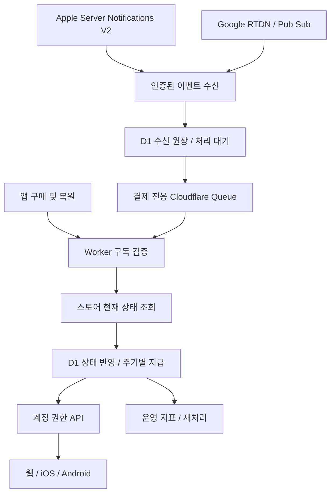

# 구단주 월정액 멤버십 설계

작성: 2026-10-11. 갱신: 2026-10-12. 상태: 로컬 구현 및 스토어 준비 중. 운영 배포 금지.

## 2026-10-12 실행 범위 (이하 초기안보다 우선)

사용자 요청: 혜택 강화, 양 스토어 월 구독 상품 등록·심사 준비, 출시 기능 전체 로컬 시뮬레이터 검증, 유지 뱃지/칭호 추가. 월 4,900원은 유지한다.

- 상품: 오프사이드 클럽 멤버십, 자동 갱신 1개월, 상품 ID `com.offsidelab.app.club_monthly`. 무료 체험·약정 없음.
- 결제 주기 보너스: 리롤 40장 + 스카우트 5장 + 강화 10장. 현재 단품 구매 조합 5,500+4,400+2,200=12,100원. 현지 스토어 가격·묶음 구성에 따라 달라 할인율 마케팅은 별도 검토.
- 시즌 1 영향 사용자 보고: 확률·능력치 배수는 없으나 유료 육성 시도량을 증가시킨다. 운영 지급·판매는 아직 미적용.
- 지속 혜택: 광고 제거(기존 영구 구매 우선 보존), 시즌/은퇴 선수 3명 비교, 구단주 프레임·명패/명예관 테마 라이브러리.
- 구독 전용 클럽 서포터 칭호·뱃지: 누적 유료 결제 1/3/6/12개월 단계. 활성/스토어 승인 유예 동안만 노출. 자동 갱신 해제는 즉시 해제하지 않으며 만료/환불 시 노출을 종료한다. 무료 체험·환불 주기는 누적 제외. 누적 이력 보존, 영구 업적 칭호와 별도 분류.
- 칭호는 기존 영구 대표 칭호와 선택 관계이며, 만료 시 이전 영구 칭호로 복구한다. 결제가 업적 희소성/점수/시즌 티어를 만들지 않는다.
- 무료 프리셋 5개·무료 기록 조회·기존 선수 꾸미기는 유지한다. 시즌 점수 배수/일일 수령 조건은 포함하지 않는다. 활성 구독 중 팀 슬롯을 총 3개로 확장한다.
- 완료 기준: 실제 로컬 API·DB와 네이티브 UI 연결, 구매/복원/갱신/해지/유예/만료/환불/중복 이벤트, 영구 광고 제거 보존, 공개 노출 만료, KO/EN/JA 확인. 로컬 시뮬레이션과 실제 스토어 Sandbox 증거를 구분한다.
- Apple 첫 구독 그룹은 새 앱 버전과 동시 심사 필요. 구독 구매·혜택 기능 없는 기존 빌드로 심사 준비 완료를 주장하지 않는다. Google은 base plan 활성과 앱 심사를 구분한다. 판매/운영 서버 배포는 금지.

## PR 체크포인트 (2026-10-12)

공개 명예관과 클럽 멤버십의 현재 로컬 구현을 하나의 Draft PR로 정리한다. 머지·운영 배포·판매 활성화는 하지 않는다. 아래 항목이 이전 시점의 구현 기록보다 우선한다.

- 구현: 익명 공개 명예관과 복귀 동선, iOS 라커룸 드래그 합성 수정, 계정 귀속 구독 검증/복원, 유료 주기 아이템 원장/환불 회수, 기간제 광고 제거, 테마/프레임, 최대 3명 선수 비교, 서포터 칭호, 최대 3팀.
- 검증: API 멤버십/팀 슬롯 87개, 추가 슬롯/결산/프로필 회귀 9개, 네이티브 결제/광고 16개, 모바일 웹 KO/EN/JA 및 초안 분리 E2E 4개 통과. API/웹/앱 타입 검사 통과. iOS 실제 로컬 API의 3팀 저장 결과와 화면을 확인했다. 실제 스토어 결제 증거와 구분한다.
- 미완료: 실제 Apple/Google Sandbox 구매·갱신·환불, Android 화면 검증, 스토어 키/서버 알림 운영 연결, Google 누락 중간 갱신 복구, 접속 중 채팅의 환불 즉시 반영, 독립 알림 재처리/Queue 확장.
- 신규 요청 / 구현 전: 시즌마다 열리는 컵 자동 참가 신청. 활성/유예 구독의 명시적 켜기/끄기 설정, 대표 팀 슬롯 0, 기존 자격과 선착순 정원, 중복 방지, 수동 취소한 대회 재신청 방지를 기준으로 후속 구현한다. 참가 자리 보장이나 추가 팀 출전 혜택으로 표현하지 않는다.
- 멤버십 릴리즈 노트는 `docs/tracking/release-notes-drafts/club-supporter.json`에 초안으로 보관한다. 공개 명예관의 사용자 안내는 기존 `.release-notes/2026-10-12-public-owner-hall.json`을 포함한다. 멤버십 출시 시 실제 제공 범위에 맞춰 별도 게시 항목을 준비한다.

## 팀 슬롯 및 클라이언트 구현 (2026-10-12)

- 사용자 확정: 대표 팀 1개만 공식 랭킹·시즌 보상·컵에 참가한다. 추가 2개 팀은 편성·각 팀 프리셋·친선전용이다. 대표 팀 교체 기능은 이번 범위에 포함하지 않는다.
- 기존 모든 팀은 슬롯 0으로 보존한다. `(profile_id, season, slot)` 유일 제약으로 시즌마다 최대 3개의 독립 팀을 저장한다. API는 슬롯 0/1/2만 허용하며 생략하면 기존 팀이다.
- 활성/유예 구독은 슬롯 1·2의 생성/수정/친선전을 허용한다. 만료/환불/보류 시 추가 팀은 삭제하지 않고 조회만 허용한다. 재구독 시 같은 팀을 다시 쓴다.
- 선수 소유권은 구단주 단위이며 같은 보유 선수를 각 팀에 편성할 수 있다. 팀 슬롯이 아이템 수량이나 친선전 일일 횟수를 복제하지 않는다. 공식 경쟁은 기본 슬롯만 집계한다.
- 웹·앱 `내 구단 → 클럽 멤버십`에서 혜택과 상태를 확인한다. 웹은 앱 전용 가입을 안내하며 스토어 결제를 실행하지 않는다. 앱에는 구매/복원/구독 관리 진입을 연결했다. 판매 플래그는 아직 꺼져 있다.
- 테마/프레임 저장은 서버 권한 검사 후 공개 명예관/프로필에 적용한다. 내 선수에서 은퇴 기록 최대 3명을 비교한다.
- 320px 웹 KO/EN/JA 가입 안내 및 꾸미기 저장 테스트, 팀별 초안 분리 테스트 통과. iOS 393pt KO/EN/JA 화면 확인은 로컬 fixture이며 실제 스토어 결제 증거가 아니다.
- 미완료 출시 검증: 실제 Sandbox 거래 및 갱신/환불, Google 누락 갱신 복구 확대, 연결 중 채팅의 환불 칭호 갱신, 전체 기능 실제 API 연결 시나리오, Android 화면 확인. 판매/운영 배포는 진행하지 않는다.

## 1. 초기 상품 정의와 결정 기록 (상단 실행 범위로 대체됨)

| 항목             | 설계                                                                          | 상태                                      |
| ---------------- | ----------------------------------------------------------------------------- | ----------------------------------------- |
| 한국 월 가격     | 4,900원                                                                       | 사용자 확정. 실제 표시는 스토어 현지 가격 |
| 상품명           | 오프사이드 클럽 멤버십                                                        | 제안                                      |
| 과금             | 약정 없는 월 자동 갱신 1종. 연간·무료 체험·가입 할인 없음                     | 초기안                                    |
| 소유 단위        | 구단주 계정 1개. 여러 팀을 보유해도 지급량 동일                               | 추천                                      |
| 지속 혜택        | 구단 분석실, 꾸미기 라이브러리, 이용 기간 광고 제거                           | 구현 필요                                 |
| 결제 주기 보너스 | 리롤권 10장 + 프리미엄 스카우트권 2장                                         | **밸런스 검토 전 제안값**                 |
| 제외             | 강화권, 능력치·확률·점수 배수, 자금, 추가 팀·컵 참가권, 구독 연속 유지 보너스 | 초기 범위                                 |
| 출시             | 시즌 경계 권장. 시즌 1 중 경쟁 혜택 도입은 영향 보고 후 결정                  | 미정                                      |

월간 아이템만 묶은 정기 배송 상품이 아니라, 계속 사용하는 기능에 대한 구독으로 만든다. Google은 지속 가치 없이 일회성 재화·부스터만 주는 구독을 제한한다. 보너스를 빼도 기능에 지불할 이유가 있어야 한다. 기능이 준비되지 않으면 구독 출시를 미루고 비갱신 패키지를 별도로 검토한다.

## 1-1. 프리셋 제외 후 상품성 재검토 (2026-10-11)

**판정: 월 4,900원은 유지하되 현재 구성의 구매·갱신 가치는 아직 입증되지 않았다. 결제 구현보다 지속 혜택의 실물 검증을 먼저 한다.** 아래는 코드·현재 상품 설계 가격에 기반한 판단이며 실제 결제 전환율이나 가격 탄력성 분석 결과가 아니다.

### 기존 상품과 비교

| 비교                            | 금액    | 의미                                                                               |
| ------------------------------- | ------- | ---------------------------------------------------------------------------------- |
| 리롤 5장 × 2 + 스카우트 1장 × 2 | 4,400원 | 제안한 보너스 10장/2장을 정확히 구매하는 소액 상품 합계                            |
| 리롤 15장 + 스카우트 1장 × 2    | 4,400원 | 구독보다 500원 저렴하며 리롤은 5장 더 많음                                         |
| 대량 묶음 단가로 10장/2장 환산  | 3,135원 | 리롤 40장 5,500원, 스카우트 5장 4,400원의 단가 환산. 실제 3,135원 구매 조합은 아님 |

현재 설계 가격 기준이며 국가별 실제 스토어 가격은 다를 수 있다. '4,900원으로 4,400원 이상 혜택', '구독이 가장 저렴' 같은 할인 광고는 하지 않는다. 필요 이상의 묶음을 사야 하는 단가 환산과 실제 지출을 구분한다.

- 광고 제거 보유자: 월 이용료 전부를 추가 기능·아이템으로 납득해야 한다. 광고 제거를 매월 3,300원 상당으로 계산하지 않는다.
- 미보유자: 구독 기간의 광고 제거는 진입 동기가 될 수 있지만 영구 상품이 3,300원이므로 장기 갱신 이유로는 약하다.
- 가벼운 이용자: 매달 아이템이 남으면 갱신 이유가 약해진다. 미사용 아이템을 소멸시키거나 출석을 강제해 해결하지 않는다.
- 반복 육성 유저: 비교·분석을 자주 쓴다면 가치가 생길 가능성이 있다. 아직 가설이며 기능 사용과 구독 의향을 검증해야 한다.

### 분석실의 현실적인 범위

확인 근거: `packages/contracts/src/owner-summary.ts`, `careers.ts`, `apps/api/src/cron/seasonTelemetryArchive.ts`, 기존 `OwnerArchive`.

- 구단주 요약에는 시즌별 티어와 은퇴 선수의 시즌·레전드 점수·영구결번 등 제한된 필드가 있다. 이것만으로 모든 분석을 만들 수 없다.
- 세부 성장·이벤트 측정은 `season_telemetry`에서 7일 이후 R2 압축 파일로 이관한다. R2에 존재한다는 사실과 사용자별 빠른 조회 API가 있다는 사실은 다르다. 런타임에 보관 파일 전체를 스캔하지 않는다.
- 최초 분석 목업은 저장된 은퇴 선수 최대 3명 비교와 확보 가능한 시즌 성과 비교로 한정한다. 선수 커리어의 연차와 서비스 시즌을 분리한다.
- '모든 시즌의 세부 성장 그래프'는 초기 상품 약속에서 제외한다. 향후 사용자별 요약/인덱스·보존 비용·소급 가능성 확인 후 별도 판단한다.
- 같은 포지션·서비스 시즌 등 조건을 맞추고 최고 OVR, 경기당 기록 등의 표본/분모를 함께 표시한다. 단순 비교를 승리 예측·성공 보장으로 표현하지 않는다.
- 원본 기록과 기존 상세는 계속 무료다. 추가 유료 가치는 일괄 비교·집계·읽기 쉬운 변화 분석에 있어야 한다.

### 꾸미기 중복과 운영 부담

[#609](https://github.com/tasddc1226/offside-football-simulator/pull/609)는 확인 시 OPEN이며 선수 자금으로 도트 선수 외형을 꾸미고 은퇴 시 고정하는 기능이다. 구독 때문에 이 선택지를 잠그거나 결제 통화를 바꾸지 않는다.

구독 외형은 구단주 프레임·명패·명예관 공간 테마로 한정한다. 구독 중 쓰는 라이브러리는 지속 접근 기능이지만, 작은 정적 라이브러리만으로 매달 비용을 납득할지는 검증이 필요하다. 매월 신규 아트 제공을 약속해 운영 부담을 먼저 만들지 않는다. 업적 칭호·기존 무료 외형의 가치를 훼손하지 않는다.

### 수정된 진행 결정

1. 무료 프리셋 5개 유지, 구독 프리셋 확장 없음. 추가 팀 슬롯도 이번 범위에서 제외.
2. 가격 4,900원 유지. 10/2는 밸런스 검토용 가설로 유지하며 이번 검토에서 수량·확률을 변경하지 않음.
3. 실제 저장 기록으로 비교 분석 목업 1개, 기존 구단주를 사용한 외형 미리보기 1개를 먼저 만든다. 무료 기록 화면과 나란히 비교해 차이를 설명할 수 있어야 한다.
4. 광고 제거 보유/미보유, 반복 육성/가벼운 이용자를 구분해 소규모 사용자 검증을 한다. '좋다'보다 '4,900원에 매달 쓸 이유', '어떤 기능을 언제 다시 쓰는지', '아이템이 없어도 쓸 기능'을 확인한다. 소수 응답을 시장 전환율로 일반화하지 않는다.
5. 지속 기능을 반복해서 쓸 이유가 확인되면 결제 원장·스토어 연동 구현으로 진행한다. 아이템 때문에만 결제하려는 응답이면 자동 갱신 없는 패키지 대안을 먼저 검토한다. 이는 구독 가격 승인 철회가 아니라 상품 출시 가능성의 검증이다.
6. 첫 유료 갱신 주기가 지난 뒤 실제 기능 이용·갱신·환불·단품 대체를 함께 평가한다. 모든 유료 기능이 완성되기 전에는 일반 사용자에게 구독을 판매하지 않는다.

Google 구독 정책상 아이템 보너스는 지속 가치에 부가적이어야 한다. 분석실이나 외형 이름만 넣으면 심사가 보장되는 것은 아니다. 반복 사용 가치가 없는 상태를 아이템 증량으로 메우지 않는다.

## 2. 기능별 최소 출시 범위

### 구단 분석실

- 기존 명예관·시즌 기록·내 선수 목록·단일 선수 상세는 무료로 유지한다.
- 신규 유료 기능: 저장된 시즌 성적 비교, 은퇴 선수 최대 3명 나란히 비교. 전 기간 세부 성장 추이는 초기 약속에서 제외한다.
- 비교 기준: 시즌, 원래 포지션, 출전, 득점·도움, 최고 OVR, 은퇴 가치 등 실제 저장된 필드만 사용한다. 다른 기준의 레전드 점수·가치를 섞어 합산하지 않는다.
- 세부 데이터 소스 매핑을 구현 첫 단계에서 작성한다. 서버에 없는 과거 성장 이력을 추정·복원하지 않는다. 기기 로컬 기록만 있는 경우 적용 범위를 표시한다.
- 누락 기록은 0으로 계산하지 않고 '기록 없음'으로 처리한다. 소급 수집 불가능한 지표는 출시 약속에서 제외한다.
- 결과는 플레이에 따라 갱신된다. 별도 수작업 월간 보고서 제작을 지속 운영 의무로 만들지 않는다.

### 기존 팀 프리셋과의 경계 (2026-10-11 정정)

최신 PR을 확인하기 전 제안한 '구독 추가 프리셋 3개'는 기존 작업과 중복되어 철회한다.

- [#643](https://github.com/tasddc1226/offside-football-simulator/pull/643): 시즌 팀 배치 프리셋 6종(4-2-3-1, 4-1-4-1, 4-3-3 F9, 4-4-1-1, 3-4-3, 5-3-2). 확인 시 main `9f0d8580`에 머지됨. 저장된 내 편성 목록과 다른, 기본 배치 템플릿이다.
- [#645](https://github.com/tasddc1226/offside-football-simulator/pull/645): 팀별 포메이션·선발·좌표 배치를 이름 붙여 최대 5개 저장, 덮어쓰기·이름 변경·삭제·불러오기. 확인 시 OPEN, head `5427a40a`. 서버·웹·앱 구현에 구독 제한 없음.
- #645의 저장은 `owner_teams.presets_json`, 조회는 기존 팀 응답의 `presets`, 쓰기는 `PUT /v1/owner-team/presets`다. 별도 프리셋 테이블·구독 전용 API를 만들지 않는다.
- 불러오기는 편성 초안에 적용하고 별도 팀 저장으로 확정한다. 없는 선수 자리 비우기, 지난 시즌 수정 제한, 컵 명단 잠금도 해당 PR의 동작을 그대로 유지한다.
- 배치 템플릿과 무료 저장 5개는 구독 가입·만료와 무관하게 유지한다. 구독 프리셋 수량 확장도 초기 상품에서 제외한다.
- PR 머지는 운영 배포 증거와 다르다. 이번 확인에서 #643 운영 반영과 #645 머지·배포 완료를 주장하지 않는다.
- 프리셋을 제외한 지속 혜택만으로 월 4,900원의 이용 가치가 충분한지 다시 검증한다. 이를 보상하려고 아이템 수량을 자동 증액하지 않는다.

### 꾸미기 라이브러리

- 출시 목표: 명예관 테마 2개, 프로필 프레임 3개, 명패 스타일 3개(제안). 기존 도트 축구·라커룸 시각 언어 사용.
- 이용 중 라이브러리를 선택·변경할 수 있다. 매월 신작 제공이나 영구 지급을 약속하지 않는다.
- 만료 시 기본 외형으로 표시하되 선택값은 보존한다. 재구독 시 유효한 선택 복구.
- 업적 영구 칭호의 등급·도트 휘장과 구독 외형을 분리한다. 채팅·댓글에서 유료 이용자의 메시지를 우선 노출하지 않는다.
- 타인이 보는 외형은 서버가 유효한 구독 상태를 반영하고 캐시 만료 시간을 권한 만료일 이내로 제한한다.

### 광고 제거와 기존 구매자

- 적용 식: `effectiveAdFree = permanentAdFree || membershipAdFree`.
- 구독 만료가 기존 영구 구매의 로컬 값이나 스토어 복원 결과를 덮어쓰면 안 된다.
- 구독 혜택을 기존 `offside_ad_free` 영구 플래그에 기록하지 않는다. 별도 만료 권한으로 관리한다.
- 영구 구매 3,300원 상품을 유지하고, 이미 보유한 사용자에게 '기존 광고 제거는 계속 유지돼요'를 표시한다.
- 기존 영구 상품은 스토어·기기 기반이며 구독은 계정 기반이다. 영구 상품의 플랫폼 간 이관은 이번 범위에 포함하지 않는다.
- 보상형 광고 건너뛰기는 기존 광고 제거와 같은 규칙을 적용한다. 광고 보상 횟수·게임 조건은 늘리지 않는다.

## 3. 시즌 밸런스 및 가격 검토

리롤권 10장과 스카우트권 2장은 1결제 주기 최대 12번, 총 36개의 새 후보를 볼 기회다. 36명 영입이 아니며, 실제 소비율·기존 단품 구매 대체 여부에 따라 순증은 다르다. 구독자에게 월별로 이 기회가 반복되므로 확률이 같아도 경쟁에 영향을 준다. 광고 제거로 인한 보상 접근성 변화도 포함해 평가한다.

출시 전 보고 항목:

1. 현재 선수 생성·리롤·스카우트 이용량과 보유량의 중앙값/P90, 결제 유저와 전체 구단주 분리.
2. 기존 운영 확률·고정 시드로 추가 후보 선택 기회의 잠재력·최고 OVR 분포 비교. 시뮬레이션 가정과 실제 유저 행동의 차이 명시.
3. 월간 지급안 0/0, 10/2 및 더 적은 대안의 변화. 실제 시즌 길이에 걸쳐 몇 번 결제되는지도 반영.
4. 단품 구매 대체, 광고 제거 매출·광고 수익 감소까지 포함한 전체 수익 가설. 4,900원을 순수익으로 표기하지 않는다.
5. 사용자에게 결과 보고 후 수량·시점 확정. 기존 게임 확률·성장률을 바꿀 필요가 생기면 별도 밸런스 변경으로 다룬다.

혜택 버전(`benefit_version`)을 결제 주기에 고정한다. 지급량을 바꾸어 이미 결제된 기간에 소급 적용하지 않는다. 아이템 없이 먼저 출시한다면 다른 구성임을 다시 명시하고 확정한다. 승인되지 않은 수량을 판매 화면에 약속하지 않는다.

## 4. 결제·지급·만료 규칙

| 사건                      | 이용 권한                          | 보너스                                     |
| ------------------------- | ---------------------------------- | ------------------------------------------ |
| 첫 결제 검증 성공         | 스토어가 정한 만료 시각까지 활성   | 최초 유료 주기에 1회                       |
| 정상 유료 갱신            | 새 만료 시각 반영                  | 새 유료 주기에 1회                         |
| 자동 갱신 해제            | 결제된 기간까지 유지               | 현재 지급 유지, 해제 자체로 추가 지급 없음 |
| 결제 대기                 | 새 권한 부여 안 함                 | 없음                                       |
| 스토어가 인정한 결제 유예 | 확인된 유예 종료까지 이용          | 미결제 주기는 지급 안 함                   |
| 보류·유예 종료·만료       | 권한 종료                          | 이미 정상 지급된 아이템 유지               |
| 결제 복구                 | 검증된 유효 기간 반영              | 확인된 미지급 유료 주기만 지급             |
| 복원·재로그인·앱 재설치   | 같은 계정 권한 복구                | 중복 지급 없음                             |
| 환불·권한 회수            | 스토어의 현재 유효 권한으로 재계산 | 환불 주기만 별도 회수 규칙 적용            |

- 매월 1일이나 임의의 30일이 아니라 스토어 결제 기간을 사용한다. 월말·윤년·시간대는 스토어 시각을 그대로 저장하고 현지 표시만 변환한다.
- 로그인이 없어도 갱신 확인 시 서버 지급. 출석·수령 버튼·연속 접속 조건·미접속 소멸 없음.
- 자동 갱신 해제와 환불을 구분한다. 일반 해지로 아이템·기록을 회수하지 않는다.
- 환불 제안: 해당 지급분의 미사용 수량만 회수하고 이미 사용한 선수·커리어는 되돌리지 않는다. 잔액 음수 금지. 출처별 사용 내역이 없으면 다른 단품 구매 아이템을 차감하지 않고 운영 검토로 넘긴다.
- 회수 정확도를 위해 보너스 지급 lot과 사용 출처를 기록한다. 기존 미추적 잔액은 별도 legacy lot으로 이관하는 방안을 검증한다. 회수 정책은 출시 전 확정한다.
- 샌드박스는 별도 원장·지급 영역 또는 허용된 테스트 계정으로 격리하며 운영 매출 집계에 포함하지 않는다.
- 최초 구매는 복구 가능한 로그인 계정 필수. 구독 원본 거래와 구단주를 고정 연결하고 자동 계정 병합·이전은 하지 않는다.
- 여러 팀에 월 지급량을 복제하지 않는다. 아이템은 구단주 공유 재고다.
- 웹은 혜택 사용·상태 조회를 지원하고 결제 판매는 앱부터 시작한다. 스토어별 관리 링크는 지원되는 환경에서 제공한다.
- 동일 계정의 다른 스토어 구독을 조회해 구매 버튼을 막는다. 동시 구매·스토어 외부 재구독으로 중복이 생길 수 있으므로 완전 차단을 약속하지 않는다. 두 결제를 모두 원장에 남기고 기간·보너스를 임의 합산하지 않으며 구독 관리·지원 경로를 제공한다. 중복 과금 처리·환불 절차는 출시 전 확정한다.

## 5. 서버 구조

현재 확인한 연결점:

| 기존 위치                                          | 용도                       | 확장 방향                                           |
| -------------------------------------------------- | -------------------------- | --------------------------------------------------- |
| `apps/mobile/src/platform/store.ts`, `iapItems.ts` | expo-iap 연결·소모성 구매  | 별도 subscription 모듈로 구매·복원 추가             |
| `apps/mobile/src/platform/adFree.ts`               | 영구 광고 제거             | 영구 소유와 기간 권한 분리                          |
| `apps/api/src/iap/verify.ts`                       | 소모성 검증                | 재사용 가능한 인증 유틸만 공유, 구독 전용 검증 추가 |
| `apps/api/src/db/repos/iap.ts`                     | 거래 원장·owner_items 지급 | 구독 주기 원장과 원자적 지급 추가                   |
| `apps/api/src/index.ts`, `wrangler.jsonc`          | 푸시 Queue 분기            | 결제 전용 consumer 명시 분기                        |
| `packages/contracts`, `packages/app-core`          | 공용 계약·API·사전         | 웹/앱 동일 권한·상태 계약                           |



### 이벤트 처리

- 기존 푸시 Queue의 작업 형식을 섞지 않는다. `BILLING_QUEUE`와 DLQ를 별도로 둬 푸시 대량 발송·장애와 분리한다.
- Apple 서명·인증서·앱·환경을 검증한다. Google은 Pub/Sub push의 OIDC 서명, audience, 서비스 계정을 검증하고 package/product를 대조한다. 인증 없이 클라이언트가 보낸 만료일은 신뢰하지 않는다.
- Google RTDN은 변화 알림이며 현재 상태는 `purchases.subscriptionsv2.get`으로 확인한다. Apple 알림과 Server API로 거래·갱신 상태를 대조한다.
- 검증된 이벤트를 수신 원장에 영속 저장한 뒤 수신 성공 처리한다. D1 저장과 Queue 전송 사이 장애를 복구할 outbox/처리 대기 스캔을 둔다. 저장 실패를 성공 응답하지 않는다.
- 소비자는 이벤트 순서가 뒤섞이거나 반복되어도 현재 스토어 상태를 기준으로 반영한다. 조회 실패가 활성 상태를 만료 상태로 덮어쓰면 안 된다. 오래된 조회 결과가 최신 상태를 덮어쓰지 않도록 revision/CAS 검증과 재처리를 둔다.
- 권한, 주기 지급 원장, 아이템 증가를 D1 트랜잭션/batch로 묶는다. 적용 완료 후 Queue ack. 처리 후 ack 직전 장애에도 지급은 한 번이다.
- 구독은 소모성처럼 consume하지 않는다. 각 스토어에서 필요한 구매 완료·승인 처리를 서버 검증/영속화 후 수행하고 실패는 재시도한다.
- 만료 권한은 cron 성공에 의존하지 않고 서버 현재 시각으로 판정한다. 누락 알림·미처리 이벤트만 인덱스 기반 제한 배치로 복구한다. 매 화면 진입마다 스토어를 호출하지 않는다.
- 앱이 늦게 복원하더라도 미처리된 실제 유료 갱신을 거래 이력과 대조한다. '마지막 상태 조회' 하나로 과거 결제 주기를 모두 지급했다고 간주하지 않는다.

### 데이터 모델 초안

모든 PK/unique key에 필요한 store·environment 구분을 포함한다. 실제 이름·타입은 migration PR에서 확정한다.

| 테이블                         | 핵심 내용 / 제약                                                                                                                                                                      |
| ------------------------------ | ------------------------------------------------------------------------------------------------------------------------------------------------------------------------------------- |
| `owner_subscriptions`          | profile, store, environment, product, subscription_chain, status, paid_until, grace_until, auto_renew, verified_at, revision. chain unique, profile/status 및 다음 재확인 시각 인덱스 |
| `subscription_events`          | store, environment, event_id unique, 처리 상태, attempts, next_attempt_at, sanitized error. 상태/재시도 시각 인덱스                                                                   |
| `subscription_periods`         | 원본 유료 거래 식별자 unique, 기간 시작/종료, benefit_version, 지급/환불 상태. profile/created_at 인덱스                                                                              |
| `owner_item_lots` 및 사용 연결 | 지급 출처·아이템·원수량·잔량, 소비/환불 추적. 음수·이중 회수 방지                                                                                                                     |
| `owner_cosmetic_preferences`   | 선택한 테마/프레임/명패. 실제 노출은 서버 권한과 결합                                                                                                                                 |

Apple 갱신 거래 ID, Google의 갱신별 확인 가능한 주문/거래 식별자를 주기 멱등 키로 매핑한다. Google purchaseToken 하나가 여러 갱신에 사용될 수 있으므로 token만 지급 키로 삼지 않는다. 정확한 매핑은 Sandbox 최초·갱신·복구 증거로 고정한다. 단순히 현재 달/만료일로 키를 만들지 않는다.

구매 토큰은 로그·분석 이벤트에 남기지 않는다. 재검증에 필요한 비밀 자료는 암호화·접근 제한하고 운영 화면에는 내부 참조만 노출한다. 수신 payload 보존 기간과 삭제 정책은 구현 전 보안/개인정보 항목으로 확정한다.

### API 초안

- `GET /v1/membership/catalog`: 공개 혜택 버전·기능 설명. 로그인 없이 edge cache. 변경 시 purge. 실제 스토어 가격은 앱이 조회.
- `GET /v1/membership`: 본인 상태, capabilities, 이용 종료일, 다음 결제일(확인 가능할 때), 마지막 지급 내역, 관리 스토어. 인증 필수, 공유 캐시 금지.
- `POST /v1/membership/claim`: 스토어 증빙 검증·최초 연결·복원. 동일 거래 재전송 허용, 다른 계정 연결 거절.
- `POST /v1/billing/apple/notifications`, `/google/notifications`: 스토어 인증, rate/body limits, 수신 원장.
- 분석 API: 본인 소유/권한 검증. 공개 프로필에서 비공개 분석을 반환하지 않는다.
- 운영 API: 상태·원장 조회, 검증 재시도. 권한 있는 운영자만 사용하며 감사 기록. 임의 만료일 편집을 기본 기능으로 넣지 않는다.

계정 변경 시 권한 메모리 캐시와 오프라인 캐시를 분리/초기화한다. 웹은 `cachedGet`, 동시 요청 병합을 사용하고 구매·복원·로그인 변경 후 명시적 무효화한다. 마지막으로 검증된 권한을 알려진 종료 시각까지 사용할 수 있도록 하되 무기한 오프라인 권한을 허용하지 않는다. 환불 지연·오프라인 유예 범위는 QA에서 명시한다. 서버 기능 권한은 항상 서버 판정이 우선이다.

## 6. 화면과 문구 설계

구단주 화면에 작은 멤버십 진입 카드 1개를 둔다. 상세 페이지에서 혜택·월 가격·자동 갱신·해지·복원을 한곳에서 확인한다. 강제 진입 팝업·중복 가입 버튼·매일 수령 버튼은 두지 않는다.

```text
[뒤로] 클럽 멤버십
구단 분석 · 명예관 꾸미기

월 {스토어 가격} / 매월 자동 갱신
[분석실 비교 예시]
[시즌·선수 비교] [꾸미기 미리보기]
이용 기간 광고 제거
결제 주기마다 받는 아이템 {확정된 지급량}

해지해도 결제한 기간까지 이용해요.
기존 광고 제거 구매는 계속 유지돼요.  ← 보유자
[월 {스토어 가격}에 구독하기]          ← 주 CTA 1개
구매 복원   이용약관   개인정보 처리방침
```

- 활성 상태에서는 가입 CTA 대신 이용 종료/다음 갱신 정보·지급 내역·구독 관리를 표시한다. 갱신 해제 시 '다음 결제'를 표시하지 않는다.
- 결제 후 서버 지급 대기는 '구매 확인 중' 상태로 전환하고 재결제를 유도하지 않는다. 복원·재확인 경로 제공.
- 프레임 미리보기에는 실제 구단주명과 칭호를 사용한다. 기존 녹색·황동 라커룸 토큰을 재사용하고 가격은 읽기 쉬운 기본 폰트를 사용한다.
- 320/360/390px, KO/EN/JA, 큰 글씨, 스크린리더, 터치 최소 44px, safe area, 하단 탭·CTA 겹침과 가로 넘침 확인.
- 애니메이션은 외형 선택/적용 결과에만 짧게 사용하고 reduced motion 준수. 가격·갱신 조건은 접거나 작은 글씨로 숨기지 않는다.
- 웹은 사용 중인 혜택·상태를 보여 주고 미가입자는 앱 구매 안내. 결제 링크 정책은 구현 시 스토어/지역별 최신 기준 재검토.
- 문구는 `packages/app-core/src/i18n` KO/EN/JA에서 공유. 이 문서의 문구는 초안이며 실제 UI 사전은 아직 만들지 않는다.

## 7. 운영 및 측정

운영 도구에 '멤버십' 영역을 별도로 추가한다. 앱 푸시 발송 화면을 매출 원장으로 사용하지 않는다.

- 스토어별 활성 유료/유예/갱신 해제/만료 계정 수, 갱신 성공·실패·환불, 처리 지연·DLQ·미지급 건.
- 구단주별 구독 상태, 검증 시각, 유료 주기·아이템 지급/회수 이력, 실패 이유, 안전한 재처리.
- GA 이벤트: 상세 열기, 혜택 미리보기, 구매 시작, 분석실/꾸미기 사용, 구독 관리 열기. 결제 확정·갱신은 검증된 서버 원장 기준.
- 거래 ID·구매 토큰·이메일은 GA에 보내지 않는다. GA 추정 매출과 스토어 정산액을 구분한다.
- 첫 갱신율 = 갱신 예정일이 실제 도래한 최초 유료 cohort 중 성공 갱신 비율. 아직 만기가 안 된 가입자는 분모에서 제외하고 유예 중은 별도 표시.
- 결제 유저의 원래 높은 활동량을 고려해 단순 구독자/비구독자 차이를 리텐션 인과 효과로 주장하지 않는다. 가입 전후·유사 활동 cohort와 함께 본다.
- 단품 매출·광고 매출 감소, 수수료·세금·환불·추가 비용을 포함한 순증 기여 검토. 초기 표본으로 가격 최적화를 단정하지 않는다.
- 월 아이템 지급 푸시는 기본 발송하지 않는다. 지급 내역으로 확인하고 필요한 결제 문제 안내는 기존 피로도/중복 방지 규칙과 연결한다.

## 8. 순차 작업과 완료 조건

| 순서 / PR 단위        | 작업                                                                                | 완료 증거 / 다음 단계 조건                                |
| --------------------- | ----------------------------------------------------------------------------------- | --------------------------------------------------------- |
| 0. 설계               | 이 문서, 가격 확정·미정사항 분리                                                    | 문서 검토, 운영 변경 없음                                 |
| 1. 데이터·밸런스 검증 | 분석 지표 source map, 현재 이용량, 0/0·10/2 등 지급안 비교, 수익 가설               | 실제 기록으로 분석 목업 가능. 수량·출시 시점 사용자 결정  |
| 2. 계약·원장          | 공용 상태 계약, 신규 D1 migration, 혜택 버전, 환경 구분·권한 캐시, 아이템 출처 원장 | 로컬 migration/기존 잔액 보존/중복·경합 테스트            |
| 3. 스토어·Queue       | 구독 검증, 알림 인증, inbox/outbox, 전용 Queue/DLQ, 재검증·복원                     | Sandbox 갱신·중복·순서 역전·장애 복구·다른 계정 거절 검증 |
| 4. 지속 혜택          | 분석실 → 꾸미기 → 광고 권한 합성                                                    | 웹/앱 동일 권한, 만료 시 기존 기록·영구 광고 제거 유지    |
| 5. 구매·관리 UI       | 스토어 상품 조회/구매/복원/관리, KO/EN/JA                                           | 실기기 iOS/Android 구매·해지·재설치 및 웹 반영 확인       |
| 6. 운영 도구          | 원장·상태·미지급·재처리·cohort 지표                                                 | 안전한 재처리로 중복 지급 없음, 운영 알림 확인            |
| 7. 출시 검증          | Sandbox 통합 시나리오, 릴리즈 노트, 스토어 심사, 허용 계정으로 확인                 | 승인된 혜택과 판매 화면 일치, 양 플랫폼 결과 기록         |
| 8. 공개·관찰          | 단계적 노출, 오류/지급 지연 확인, 첫 갱신 cohort 관찰                               | 실제 갱신·지급·매출 증거 후 확대 결정                     |

2~6은 단계별 PR로 리뷰 가능하나, 지속 혜택·구독 운영이 완성되기 전에는 일반 유저 판매를 열지 않는다. 구현 브랜치는 시작 시 최신 main에서 분리하고 관련 없는 로컬 변경을 보존한다.

스토어 준비 후보: Apple subscription group 1개와 monthly product, Google subscription product 1개와 monthly auto-renewing base plan. ID는 예를 들어 `com.offsidelab.app.club_monthly`; 사용 가능 여부 확인 후 확정한다. 스토어 상품 생성·심사 제출·운영 공개는 별도 실행 단계다. 기존 expo-iap가 있더라도 실제 SDK·플러그인·런타임 fingerprint 검증 전 'OTA만으로 가능'이라고 확정하지 않는다.

테스트 필수 사례:

- 최초 구매, 자동 갱신, 같은 주기의 수동 복원/알림 동시 도착, 앱 종료 직후 결제 완료.
- 월말/윤년, 오프라인, 로그인 변경, 다른 기기의 같은 계정, 다른 구단주의 복원.
- 갱신 해제→재활성, 결제 대기·유예·보류·복구, refund/revoke, 이전 알림 지연 도착.
- D1 성공→Queue 실패, 처리 성공→ack 실패, 스토어 API 일시 실패, DLQ 재처리.
- 단품 구매와 구독 보너스 동시 지급·사용, 환불 시 단품 잔액 보호, 중복 스토어 구매.
- 영구 광고 제거만/구독만/둘 다/둘 다 없음, 만료·환불 시 영구 구매 보존.
- 구독 가입·만료·환불이 무료 프리셋 5개와 현재 라인업·기존 저장 복구에 영향을 주지 않는지 회귀 검증.
- 분석 조회 N+1·화면 재진입 중복 요청 없음, 권한 없는 계정 데이터 접근 차단.
- UI 3언어 모바일, 실제 iOS/Android, 웹 혜택 공유. 수행 못 한 환경은 미검증으로 명시.

공개 중단 시 `membership_sales_enabled`로 신규 판매만 닫는다. 이미 결제된 혜택·알림 처리·복원·환불·지급은 계속 제공한다. 앱 내 버튼을 닫아도 스토어 외부 갱신이 계속될 수 있으므로 구독 중단을 단순 배포 롤백으로 처리하지 않는다. 구독 전에는 기능 플래그로 숨길 수 있지만 판매 후 약속한 혜택을 임의 제거하지 않는다.

## 9. 다음 결정과 우선 작업

먼저 **분석에 실제 쓸 수 있는 저장 데이터와 지급량 영향을 확인하는 PR 1의 조사 산출물**을 만든다. 계정 구매 시스템부터 크게 구현한 뒤 구독 가치를 찾는 순서는 피한다.

사용자에게 다음 보고 때 확정받을 항목은 (1) 10/2 또는 대안 수량, (2) 시즌 경계/시즌 1 도입, (3) 프리셋을 제외한 분석실·꾸미기 라이브러리 출시 범위와 구독 가치다. 그동안 월정액 상태 계약·로컬 테스트 설계는 수량에 독립적으로 진행할 수 있다. 환불·중복 결제·데이터 보존 정책도 판매 전 확정한다.

구현 착수 전 [#642](https://github.com/tasddc1226/offside-football-simulator/pull/642)의 인앱 환불 작업도 검토한다. 확인 시 OPEN이며, 구독 알림 수신·회수 설계와의 재사용 범위를 확인하기 전 별도 중복 기반을 구현하지 않는다.

## 10. 근거 및 한계

- 현재 상품: [iap-items-plan.md](iap-items-plan.md). 광고 제거는 로컬/스토어 기반이고 소모성은 서버 계정 원장 기반임을 현재 코드에서 재확인했다.
- [Google 구독 정책](https://support.google.com/googleplay/android-developer/answer/9900533?hl=en): 지속 가치, 보너스의 부가적 역할, 가격·갱신·관리 안내.
- [Apple 구독 안내](https://developer.apple.com/app-store/subscriptions/): 지속 서비스·기능 제공.
- [Google 구독 생명주기](https://developer.android.com/google/play/billing/lifecycle/subscriptions): RTDN과 최신 상태 조회, 유예·보류·갱신 처리.
- [Apple 알림 응답과 복구](https://developer.apple.com/documentation/appstoreservernotifications/responding-to-app-store-server-notifications): 상태/거래/알림 이력으로 누락 복구.

위 문서는 2026-10-11 확인했다. 현재 상품 구현을 확인했지만 구독 SDK 호환성, 실제 데이터 가용성, 정확한 스토어 주기 매핑, 가격 탄력성, 새 상품 심사·구매는 아직 검증하지 않았다. 이 문서만으로 출시 준비 완료를 의미하지 않는다.

## 2026-10-12 구독 칭호 구현 상태

- 구독 전용 `클럽 서포터` / `Club supporter` / `クラブサポーター`.
- 유료 월간 결제 이력 1/3/6/12회에 따라 bronze/silver/gold/platinum 도트 방패. 실제 누적 개월 수와 단계의 최소 개월 수를 구분한다.
- 활성/유예 기간에만 선택 가능. 자동 갱신 해지는 남은 결제 기간을 없애지 않는다.
- 재구독 시 동일 구단주의 누적 유료 기간을 이어간다. 무료 체험·환불·미래 기간·다른 스토어 환경 이력은 집계에서 제외한다.
- 영구 업적 카탈로그와 획득 수에서 제외. 별도의 구독 카드에서 선택한다.
- `profiles.title`에 구독 칭호를 덮어쓰지 않는다. 구독 선택 상태만 저장하고 조회 시 합성하여, 만료 시 기존 칭호가 자동 복구된다.
- 프로필·팀 랭킹·업적 랭킹·댓글 조회는 기존 SQL 안에서 인덱스가 있는 구독/기간 원장을 조회한다. 프로필의 일반 인증 조회에는 추가하지 않는다.
- 채팅은 작성자의 입장권 및 저장 메시지에 만료 시간을 보존하여, 만료 후 새 메시지와 재조회한 기록에서 구독 칭호를 제거한다. 이미 클라이언트에 그려진 과거 메시지는 재조회 전까지 작성 시점 표시가 남을 수 있다. 기존 공개 목록 캐시 TTL도 고려해야 한다.
- 선택·미보유 등급 거절·정확한 만료 경계·원래 칭호 보존·환불/무료체험/환경 분리 DB 테스트 완료. 웹 320px KO/EN/JA 선택/해제 테스트 완료. iOS 실제 렌더러는 HTTP fixture로 확인했으며 스토어 실결제 검증이 아니다.
- 판매는 아직 닫혀 있다. 스토어 검증·갱신/환불 이벤트·혜택 지급과 연결하기 전에는 출시 완료로 간주하지 않는다.

### 결제 주기 보상 구현 상태

- 검증된 결제 주기를 저장하는 내부 `recordMemberPeriod`와 `membership_item_lots`를 추가했다. `POST /v1/membership/claim`이 스토어 최신 상태와 계정 귀속을 검증한 뒤 호출한다.
- 결제 건·스토어·환경을 묶은 유일 키로 재전송 지급을 막는다. 무료·미래·환불 기간은 지급하지 않는다. 환불 표시는 뒤늦은 정상 이벤트로 지워지지 않는다.
- 기존 획득/단품 구매 잔액과 구독 보상 잔액을 분리한다. 사용은 구독 보상을 먼저 소진하며 환불은 해당 결제의 미사용 보상만 회수한다.
- 소프트 계정 삭제에 구독 상태·기간·보상·이벤트 삭제를 포함했다. 실제 구독 해지는 각 스토어에서 별도로 해야 한다.
- 보상 전용 4개, 기존 IAP 포함 13개, 컵/아이템 경로 22개 테스트 통과. API 타입 검사·변경 파일 lint 통과.
- **미완료**: 실제 Sandbox 구매 증거, 스토어 알림 설정과 운영 키 연결, 구매/복원 UI, 광고 제거 합성, 꾸미기/선수 비교. 서버 검증·알림·재확인 코드는 아래 상태를 참고한다. 모의 공급자 응답 테스트를 실제 결제 검증으로 간주하지 않는다.
- 구독 칭호 릴리즈 노트는 `release-notes-drafts/club-supporter.json`에 보관한 미게시 초안이다. 출시 준비가 끝난 PR에서 `.release-notes/`로 옮긴다. 실제 구독 기능 준비 및 판매 범위 확인 후 공개 명예관만 먼저 배포할 경우 이 초안은 함께 게시하지 않는다.


### 2026-10-12 서버 결제 연동 체크포인트

- Apple은 기기 JWS만으로 혜택을 지급하지 않는다. 서명 검증 후 Server API의 최신 구독 상태와 서명된 거래 이력을 조회하며, 앱·상품·환경·구매 계정이 모두 일치해야 한다.
- Google은 subscriptionsv2로 이용 기간을 확인하고 Orders API로 유료 결제 기간/환불을 확인한다. 무료 체험·기간 비례 조정은 유료 월수에서 제외한다. 구매 토큰은 계정/체인에 묶인 AES-GCM 암호문으로만 보존한다.
- 체인은 최초 구단주 계정에 귀속한다. 다른 계정 복원은 거절하고 여러 스토어의 이용 기간은 개별 보존한다. 신규 판매 플래그와 기존 구독 복원은 분리한다.
- Apple 기존 알림 경로와 Google 전용 인증 알림 경로를 연결했다. 완료한 알림은 중복 처리하지 않는다. 실패는 안전한 오류 코드만 저장하고 비정상 HTTP 응답으로 공급자 재시도를 유도한다. 원문 토큰/상세 오류 URL은 저장하거나 로그에 쓰지 않는다.
- 알림 내용의 오래된 상태를 직접 적용하지 않고 최신 스토어 상태를 다시 확인한다. Google 환불 알림의 과거 주문 ID도 별도로 재검증한다.
- 재확인 작업은 명시적으로 활성화해야 실행된다. 기존 5분 cron에서 오래된 체인을 최대 2개, 전체 45초 이내로 처리하고 실패 시 5분부터 최대 24시간까지 지수 백오프한다. 마지막 확인 6시간 경과 및 결제 종료 후 45일 이내 대상이다. 판매 플래그와 독립적이다.
- 대표 칭호는 기존 `/v1/owner/title`에서만 선택한다. appearance 수정 API는 theme/frame만 받고 칭호 권한 변경을 우회하지 못한다.
- 검증: 서버 51개 테스트 통과(결제 검증, 계정 귀속, 보상, 만료, 환불, 알림 중복/실패 재시도, Google 서명/수신 대상/서비스 계정, 기존 IAP 포함), API 타입 검사와 변경 파일 ESLint 통과.
- 아직 스토어 키를 배포하거나 알림 목적지를 설정하지 않았다. 실제 Sandbox, 앱 구매 화면, 앱 종료 중 결제, 계정 전환, 광고 권한, 실기기 통합 검증은 미완료다.
- 추가 보완: Google 미수신 기간의 알려지지 않은 중간 갱신 주문 복구, 오래된 환불 보존 범위, 알림 inbox의 독립 재처리/전용 Queue, 대규모 재확인 처리량, 환불 시 이미 접속한 채팅 작성자 권한 갱신. 현재 Google 정기 확인은 최근 알려진 주문 49개와 최신 주문을 검증하며 이를 전체 결제 이력 복구로 간주하지 않는다.
- 설정과 연동 범위는 [club-membership-server.md](../operations/club-membership-server.md)를 참고한다.
